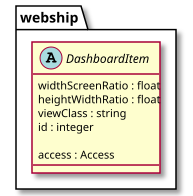

# WebShip

Contains HTML and JS implementations for the abstract Ship classes and standard implementations of common views.

## How to use?

### HtmlView.php

Most views of *WebShip* inherits properties from *HtmlView.php*. 
This class contains methods that are automatically invoked by the *(Web)Ship* engines to generate HTML, CSS, and JS code.
Usually, you do not have to do anything to start code generation.

### Create a view.

Most views of *WebShip* have a static *create* function that returns a new instance of the view desired to create. 
Sometimes, especially for older views, the *constructor* of the view must be used to create an instance. 
However, we are confident to replace those views soon.

```php
$controlPanel = ControlPanelHtmlView::create(3, 2);
```

Once the view is created, you can invoke other view-specific methods ...

```php
$controlPanel = ControlPanelHtmlView::create(3, 2);
$controlPanel->fix();
$elementsArea = $controlPanel->area(2, 1);
```

..., which are specific for the views (you have to look into the class of the view or have to use a good IDE). 
There are some methods provided by *HtmlView.php*, e.g., to add a view:

```php
$controlPanel = ControlPanelHtmlView::create(3, 2);
$view = new HtmlView();
// Add the control panel to the html view.
$view->add($controlPanel);
```

### Protocol

The most powerful thing you can do is to add functionality. 
Typically, you want to add an action if a button is pressed. 
In *(Web)Ship*, the entire concept is called *Protocol*. 
With a *Protocol*, you start to describe what to do if some event occurs:

```php
$view = new HtmlView();
$view->ref('list');

$button = StandardButtonHtmlView::create('my-beautiful-button');
$button->texts([
    Language::ENGLISH => 'Please press me!',
    Language::GERMAN  => 'Bitte drück mich!'
]);
// Add some action if the button is pressed
$button->protocol(Event::CLICK)->doIt('LoadListOfBeautifulThings', [
    'replace' => $view
], 'beautifulThings');
```

This example invokes the *Protocol Template* function ```LoadListOfBeautifulThings``` in the scope ```beautifulThings```. 
The parameters are ```replace``` meaning that the result of ```LoadListOfBeautifulThings``` seems to return a view that replaces ```$view```.

The *Protocol Template* function ```LoadListOfBeautifulThings``` is defined in a so-called *EventAdder.php* implementation. 
You just require a class that extends *EventAdder.php*, which then contains the *Protocol Template*. 
A *Protocol Template* is similar to a function that is created once but can be invoked whenever required. 
It would also be possible to define some actions directly in the *Protocol*, however, this is not recommended.

For example, the *EventAdder.php* extension with the *Protocol Template* for ```LoadListOfBeautifulThings``` could look like this:

```php
class BeautifulEvents extends EventAdder {

    public const SCOPE = 'beautifulThings';

    /**
     * @inheritDoc
     */
    public static function add() : bool {
        HtmlTemplateProtocol::_new('LoadListOfBeautifulThings', self::SCOPE)->
            action(BeautifulController::class, 'loadListOfBeautifulThings', [], [
                Language::ENGLISH => 'Load list of beautiful things ...',
                Language::GERMAN  => 'Lade List wunderschöner Dinge ...'
            ))->
            success()->
                replace(TemplateObject::_new('replace'))->
            parent()->
            fail()->
                replace(TemplateObject::_new('fail'))
            parent()->
            error()->
                add(TemplateObject::_new('error'))->
            parent();    
    
        return true;
    }
}

class BeautifulController {

    public function loadListOfBeautifulThings() : HtmlView {
        $list = new ContainerHtmlView(['ver', 'gap5']);
        $list->each([1,2,3,4,5,6,7,8,9,10], function (ContainerHtmlView $l, int $nr) {
            $beautifulThing = new HtmlView();
            $beautifulThing->texts([
                Language::ENGLISH => $nr . '. beautiful thing',
                Language::GERMAN  => $nr . '. schönes Ding'
            ]);
            $l->add($beautifulThing);
        });
        return $list;
    }

}

$actionRegister = ActionRegister::instance($app);
$actionRegister->register([
    BeautifulController::class
]);
$actionRegister->bindEvents([
    BeautifulEvents::class
]);
```

## Which persistent classes does WebShip contain?

